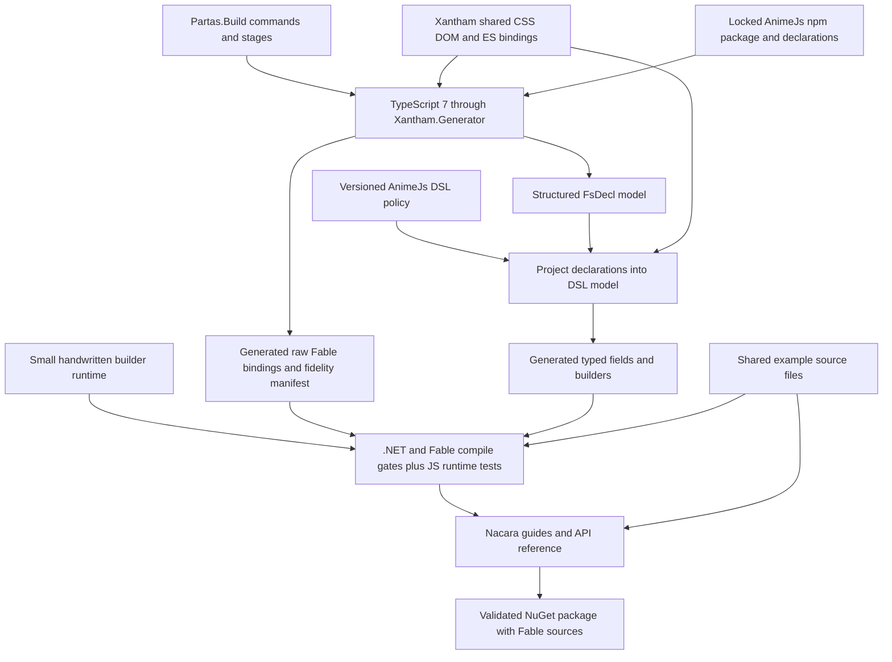

# Generate a fresh AnimeJs DSL with Xantham

Status: revision 2, approved by the user on 2026-10-08. Implementation plan: [Xantham AnimeJs DSL](../plans/2026-10-08-xantham-animejs-dsl.md). No generator implementation or dependency installation has been performed.

## Intent

Replace the repetitive handwritten binding and computation-expression surface with a reproducible pipeline consuming AnimeJs declarations through Xantham. The user explicitly selected a fresh DSL; source compatibility with the current syntax is not required. Preserve the useful capabilities: typed options, CSS and transform animation, tweens, callbacks, timelines, stagger, springs, draggables, and direct access to AnimeJs handles.

Success means that changing a pinned AnimeJs input regenerates bindings and the mechanical DSL surface together, while changes to convenience syntax live in a small, reviewable policy. Generated output must compile through both .NET and Fable and execute against the corresponding AnimeJs release.

The revised brief also requires using Xantham's maintained CSS/DOM and other useful support bindings, sharing their type identities through Xantham settings, Partas.Build for repository automation and CLI, and Nacara for documentation. Target the latest AnimeJs release, pinned exactly after resolution. This repository owns the DSL adaptation, not replacement CSS/DOM bindings, a parallel build framework, or a documentation engine.

## Verified inputs

The Xantham repository's README names this temporary source:

https://nuget.cloudsmith.io/shayanhabibi/xantham/v3/index.json

Its live search endpoint was queried on 2026-10-08 with prereleases included. Latest reported packages:

- `xantham`: **0.2.0**, the CLI tool.
- `Xantham.Generator`: **0.1.0**, the embeddable generator.
- `Xantham.TypeScript.Wire`: **0.2.1**, the generator's dependency.
- `Xantham.Fable.Core`: **0.1.1**.
- `Xantham.Fable.Core.TS`: **0.1.1**.
- `Xantham.Fable.Node`: **0.1.1**, unnecessary for this browser-oriented binding unless a demonstrated dependency needs it.

The current machine's registered Partas Cloudsmith source is a different repository; it did not return Xantham search results. The globally installed Xantham is an older alpha. Neither should determine this project's build.

The cached Generator 0.1.0 package targets .NET 10, depends on Wire 0.2.1, and identifies source commit `be513c567d24941ef77214b3cd7da0483a765377`. Its XML documentation includes the customization pipeline. The current source exposes `Pipeline.generate`, `Pipeline.generateWith`, and a `RenderModel` carrying structured `FsDecl` declarations, rendered files, and findings. This is a TypeScript 7 compiler-server pipeline, not the older JSON decoder architecture described by some external articles.

Use the project's Fable 5.20.0 and Fable.Core 5.3.0 pins. The npm registry's `animejs/latest` endpoint reports **4.5.0** on 2026-10-08; this is the new target, replacing the existing binding's 4.2.0 target. Xantham's existing AnimeJs fixture also targets 4.5.0; it supplies relevant design evidence, but is not a live passing result for this project's new DSL. Recheck the latest tag at implementation time and record its exact resolved version and integrity in the npm lockfile. Ordinary generation and CI use that lockfile, never an unpinned `latest` dependency.

The Partas.Build Cloudsmith feed reports `Partas.Build` **0.8.1**, `Partas.Build.Cmd` **0.4.0**, and `Partas.Build.Baked` **0.3.0**. Use Build 0.8.1 and Baked 0.3.0 in repository tooling, with Cmd supplied transitively unless directly referenced. Its source is:

https://nuget.cloudsmith.io/shayanhabibi/shayanhabibi-partas-build/v3/index.json

Nacara is the .NET/F# site-program architecture used by the sibling Xantham documentation project. The inspected NuGet endpoints report `Nacara.Core` **2.0.0-beta.6**, `Nacara.Plugin.FSharpApi` **1.0.0-beta.5**, `Nacara.Plugin.Markdown` **1.0.0-beta.2**, `Nacara.Plugin.Literate` **1.0.0-beta.1**, and `Nacara.Theme.Default` **1.0.0-beta.14**. These are candidate exact pins; verify their compatibility together during implementation. The repository describes this architecture as the developing v3 design, although current package numbers remain 2.x/1.x prereleases. Select packages by their actual interfaces, not by assuming all version numbers match.

## Three approaches

1. **Recommended: embed the generator and emit the DSL from its structured declarations.** One host runs Xantham, keeps its binding output, and projects `FsDecl` into a compact DSL model. This reuses resolved signatures and avoids parsing generated F#. It needs a small adapter maintained against the pinned Generator package.
2. **CLI bindings plus a separate declaration walker.** Easy to bootstrap, but independently reinterpreting TypeScript for the DSL duplicates resolution, naming, overload, and dependency decisions. A CLI manifest is not a complete type model. Avoid this as the permanent design.
3. **Extend Xantham itself with a general CE emitter.** Potentially reusable across libraries, but it pushes AnimeJs-specific language decisions upstream. Start with a consumer in this repo; extract a general emitter only after another real consumer demonstrates the same requirements.

The project-local Xantham CLI manages its pinned TypeScript compiler and supports inspecting baseline generation. The Generator library drives production generation. Partas.Build supplies the single repository CLI and invokes that library-backed work. Do not run two independent analyses to build one release or expose a second hand-wired command parser on the generator.

## Data flow



The production host has one external interface: generate a complete candidate from locked inputs, configuration, and policy, returning files and diagnostics. Candidate validation precedes replacing checked-in generated files. Generation must not partially overwrite a usable binding when a later pass fails.

## Proposed consumer language

Illustrative syntax, subject to compile and runtime acceptance tests:

```fsharp
let options = animation {
    Animation.duration 800.
    Animation.ease (Ease.named "inOutQuad")
    Transform.x (Tween.fromTo 0. 240.)
    Css.opacity (Tween.values [ 0.; 1. ])
    Animation.onComplete (fun handle -> handle.pause())
}

let handle = Anime.animate (Target.selector ".square") options

let clockOptions = timer {
    Timer.duration 1000.
    Timer.autoplay false
}

let clock = Anime.createTimer clockOptions
clock.play() |> ignore
```

Each expression inside a builder is an ordinary typed field value. These are not F# query custom operations. `animation` accepts only animation fields; `timer` accepts only timer fields. Factories consume completed options and create runtime handles explicitly. The raw generated binding remains available for the complete upstream surface.

This removes the need for one value to mean options, target builder, and running animation depending on a subsequent CE. It also avoids mixing arbitrary style expressions with query-style custom operations and implicit `For` overload resolution.

## What each module owns

### Xantham adapter

Runs the pinned Generator with the project's configuration. Preserve raw generated files and findings. Translate the public structured declarations into a repo-owned model, keeping source identity, names, aliases, generic applications, inherited members, option wrappers, callback types, overloads, and export ownership.

`RenderModel.Decls` and `FsTypeRef` are the initial consumer seam. They are package APIs rather than a promised version-independent protocol, so keep this dependency localized and test it when changing the Generator version. Resolve generated names using the configured module and declaration ownership; do not invent qualification rules from leaf names.

The semantic customization hooks can select declarations by package and source path, inspect properties and heritage, and annotate owned output targets. The existing `Companion` emitter generates marker/property adapters; it is **not** an arbitrary CE emitter. Our DSL needs its own emitter. Do not use raw declaration replacement to disguise a CE as an upstream interface.

### DSL projection

Build a small model describing an option context, its fields, accepted value types, original JavaScript keys, nested value builders, and the factory consuming it. Select contexts from factory parameters and explicitly approved policy roots, not merely type names ending in `Options`.

Follow aliases and inheritance with generic substitution. Distinguish top-level optional properties from option-valued union arms. Deduplicate union overloads after F# type mapping. Keep callback arity and result adaptation explicit. Unsupported shapes produce actionable diagnostics; they must not silently turn into an apparently typed `obj` operation.

### DSL emitter

Generate context-specific field constructors, option builders, and typed factory adapters. Reuse raw binding types for callbacks and returned handles. Avoid maintaining a second copy of AnimeJs classes, enums, and method signatures.

Internally, field construction may erase a validated value to a JavaScript key/value pair. Only generated constructors and explicit escape functions may create such fields. Builder result wrappers expose no arbitrary public cast to another option context. A timer field must fail to compile in an animation builder.

Union arms may receive convenience overloads when their mapped signatures are distinct. Retain a canonical union-typed entry point when overload resolution is ambiguous. Convenience adapters such as a `unit`-returning callback must explicitly account for the generated binding's callback result type; prove the emitted behavior in JavaScript.

### Builder runtime

A small handwritten runtime owns field accumulation and object materialization. Define `Yield`, `YieldFrom`, `Zero`, `Combine`, `Delay`, `For`, and `Run` consistently, without ambiguous overloads for arbitrary values.

Options are reusable values. Constructing options does not invoke AnimeJs. Evaluation preserves source order. Duplicate singleton fields use the last supplied value. Absent optional fields omit their keys; explicit null values remain null. Arrays remain arrays. The runtime must not accidentally reverse keyframes or mutate another builder's accumulated state.

Factories perform the actual effects. Returned handles use the generated instance methods. Introduce timeline command builders later only if they add demonstrable clarity; the first version uses `createTimeline` and the typed handle's methods.

### AnimeJs policy

The checked-in policy records semantic choices the declarations cannot tell us: factory-to-builder names, numeric conveniences, names for ambiguous unions, supported transform aliases, known option keys, dynamic property handling, and opt-in shorthand functions.

Derive known CSS field names and documentation from the pinned `Xantham.Fable.Core.TS` binding's `Fable.Core.TS.Dom.CSSStyleProperties` surface. Do not ship a replacement CSS/DOM library or a handwritten property inventory. The package already separates these style properties from `CSSStyleDeclarationBase` management members such as `cssText`, `length`, and `setProperty`; those are not animatable property fields.

Inspect the restored assembly metadata and matching XML documentation at build time to project style-property names, excluding management members, methods, indexers, and duplicate aliases. This is metadata extraction from the shared binding, not runtime reflection in the shipped DSL. Use a deterministic metadata reader, including inherited property contracts and original JavaScript names. Prefer an upstream structured catalog if a compatible package ships one later. Both routes must identify the same package/version and yield the same selected property surface.

A CSS property's DOM assignment type is not automatically its animation value type: the latter comes from AnimeJs tween signatures. Upstream CSS metadata owns property existence and docs; our projection owns wrapping it as an AnimeJs animation field. Updating the support package regenerates those wrappers automatically. Documentation must not promise that every browser implements every property or that every CSS property interpolates continuously.

Transform aliases are AnimeJs semantics, not CSS property declarations. Expose them under `Transform` (for example `Transform.x`), separate from `Css.opacity`. Derive available transforms and other useful helpers from AnimeJs/Xantham type surfaces where possible; retain only explicit convenience aliases or unexpressed semantics in policy. Reuse upstream DOM, SVG, ES collections, promises, and support types whenever signatures need them.

AnimeJs permits arbitrary object-property animation. Provide an explicit custom-property escape, keeping reserved option keys separate from dynamic property keys. Such an escape cannot prove that a target has the supplied property. Advertise that limit; do not infer target-property safety from a string.

## DOM identity and dependency policy

Reference `Xantham.Fable.Core` and `Xantham.Fable.Core.TS` at matching supported versions. Configure the compiler-library group to reference the shared producer rather than ship local copies. Align the compiler-library layout with the upstream modules:

```json
{
  "module": "Partas.AnimeJs.Raw",
  "lib": ["esnext", "dom"],
  "groups": { "typescript/lib": "reference" },
  "compilerLib": {
    "module": "Fable.Core.TS",
    "esModule": "Es",
    "domModule": "Dom",
    "autoOpenEs": true,
    "autoOpenDom": false
  }
}
```

This is the proposed configuration; validate emitted names and compile a consumer against the restored support DLLs before accepting it. Xantham's `reference` settings name a producer, but the project must still reference the package that implements those names. Other shared package groups use the same explicit reference or mapping settings when needed.

Authenticate reuse with `declarationReferences` when a matching producer catalog is distributed. The inspected Core.TS 0.1.1 NuGet cache contains the DLL and XML docs but no `declarations.json`, although the Xantham checkout has one. Therefore catalog availability is not a prerequisite for the first slice: package references, compiler-library settings, exact version pins, and consumer compile gates establish the initial reuse. Do not copy an unversioned sibling checkout catalog or generate a replacement DOM producer inside this repository. A future catalog must match the package, compiler identity, and inference profile.

Keep one DOM type family across generated raw bindings, DSL, documentation examples, and consumers. The current library uses `Browser.Types`; the new surface uses `Fable.Core.TS.Dom`. This is a permitted breaking change, documented in migration examples. Remove the legacy Browser package references once all shipped binding signatures have migrated and a package-consumption test proves no duplicate DOM family remains.

Do not map every DOM type by name or widen unlisted dependencies by default without inspecting the findings. A browser bridge can be added for a demonstrated integration; it must preserve actual emitted JavaScript behavior and cover inheritance and generic arguments.

## Repository layout and reproducibility

Proposed additions:

- `NuGet.Config`: nuget.org plus both documented Cloudsmith sources, with source mapping for `Xantham.*`/`xantham` and `Partas.Build`/`Partas.Build.*` respectively. Nacara and other ordinary dependencies resolve from nuget.org.
- `dotnet-tools.json`: project-local Xantham 0.2.0 alongside Fable 5.20.0.
- `Build.fsproj` and `Build/`: the compiled .NET 10 repository CLI built with Partas.Build and Baked. It owns options, stages, command composition, reporting, and the CI entry point; it is not packable.
- `tools/Partas.AnimeJs.Generation/`: a .NET 10 F# library referencing Generator 0.1.0; adapter, shared-binding metadata extraction, projection, policy validation, emitter, and candidate validation. The Build project calls it without a second CLI.
- `generation/`: pinned npm input, lockfile, Xantham configuration, DSL policy, and reviewed finding baseline.
- `Partas.AnimeJs/Generated/`: raw bindings and DSL output, accompanied by manifests and ordered source inventory.
- `Partas.AnimeJs/Dsl/`: the small runtime and deliberately handwritten conveniences.
- `tests/`: positive and negative compile consumers plus Node/browser runtime consumers.
- `examples/`: shared compilable consumers used by tests and Nacara documentation.
- `site/site.fsproj`, `site/Site.fs`, and `site/content/`: the Nacara site; architecture proposals remain in `docs/superpowers/` and are not published as user documentation.

The single proposed entry point is `dotnet run --project Build.fsproj -- <command>`. Partas.Build commands include `restore`, `generate`, `generate --check`, `build`, `test`, `verify`, `docs`, `docs --watch`, and `pack`. These are proposed interfaces, not installed commands. `--check` regenerates to scratch, compares deterministic output, and fails on drift. Pin latest versions after deliberate upgrades; do not restore floating latest versions on every build.

Record input package versions and integrity, compiler identity, generator version, configuration hash, policy hash, generated file hashes, and findings in provenance. Keep generation tooling out of the published runtime dependency graph. Normal consumers use the checked-in generated source and need not run Xantham or download its compiler.

## Partas.Build automation

Stages declare the inputs they read with Partas.Build's input builders, so command help and accepted options derive from the stages. Use Baked restore/build/test/pack stages where their contracts fit. Keep the DSL generation stages specific to this repository. Reuse typed producers/dependencies when several stages require the same generated candidate; do not hide generation side effects in option parsing.

The stage flow is restore locked inputs and shared packages, prepare the Xantham compiler, generate a candidate once, validate findings and determinism, compile/test the candidate, and then either compare it (`--check`) or promote it (`generate`). Build automation must bootstrap against tooling alone before the currently broken library is rebuilt. A failed generation leaves the previous checked-in output intact.

`verify` composes generation drift checks, compile gates, runtime tests, package consumption, and documentation validation. `pack` validates and produces local artifacts. CI invokes the same commands rather than duplicating generation rules in YAML. Preserve meaningful nonzero exit codes and Partas.Build reporting. Publishing packages and deploying the documentation are separate release commands; this design revision does not authorize performing either action.

## Nacara documentation

Use a compiled F# site program, following the architecture already used in Xantham's site. Start with Markdown, F# highlighting, Literate, FSharpApi, the default theme, and link validation. Add search and sitemap for the public site if their package versions are compatible. Resolve and pin one compatible set; do not copy the sibling site's floating package versions.

The documentation includes getting started, option construction versus animation execution, CSS/transforms/custom properties, callbacks, factory-family guides, migration from the old DSL and `Browser.Types`, and the regeneration workflow. Generate the public API reference from the built AnimeJs assembly and XML docs, with shared Xantham assemblies in the resolver search paths. Link to upstream shared-type documentation instead of generating a duplicate CSS/DOM reference site.

Keep guide examples in `examples/` and compile those actual files as consumers. Render or include that same source through Nacara; do not maintain a separate untested copy of each snippet. Test interactive browser demonstrations against the pinned AnimeJs version before including their assets. Live editable examples are a later addition, since their browser compiler/reference loading must be proven compatible with the selected Fable and Xantham packages.

Partas.Build's `docs` stage builds the required assembly and Nacara site; `docs --watch` runs its local watcher. Documentation validation checks routes, internal links, anchors, and example compilation. Keep external-link network checks separate from deterministic PR validation. Site publishing is outside local verification and is not performed during proposal review.

## Validation and release gates

1. **Raw generation:** no fatal resolution diagnostics. Every widened or escaped declaration used by the DSL needs a reviewed reason. Xantham's existing AnimeJs 4.5.0 golden has nonzero widened/escape counts; that is evidence that fidelity review is necessary, not a live result for this project.
2. **Determinism:** generate twice from the same locked input and compare artifacts; `--check` detects stale output.
3. **.NET compilation:** compile the raw binding, runtime, DSL, and positive consumers. This prevents repeating the current FS3866 static abstract interface failure.
4. **Fable compilation:** compile consumer fixtures using the pinned compiler. Assert meaningful interop output such as correct named imports, property keys, callback arity, and method receivers.
5. **Negative compilation:** reject wrong builder fields, wrong callback types, invalid union values, readonly assignments, and unsupported factory arguments. Each fixture checks the intended diagnostic, not just any failure.
6. **Node behavior:** compare materialized option objects, omission/null behavior, source order, duplicates, callbacks, arrays, and tween shapes. Exercise real AnimeJs against plain object targets with deterministic seeking or equivalent controls rather than wall-clock sleeps.
7. **Browser behavior:** cover DOM and SVG integration, timeline sequencing, and later scroll/draggable behavior with real browser fixtures.
8. **Package consumption:** pack and restore into an isolated consumer; compile through Fable to verify the source inventory, dependency references, and generated file ordering survive distribution.
9. **Shared-type reuse:** compile consumers taking Xantham DOM/SVG objects directly. Assert generated output references the shared identities without local copies; derive CSS fields from the restored upstream CSS metadata and verify representative ordinary, inherited, and escaped property names.
10. **Automation and docs:** exercise Partas.Build command help and stage composition, then build the Nacara site from the tested examples and the same release assembly. Verify internal links and reference resolution.

Stop generation on new unreviewed findings affecting selected DSL members. Preserve the previous candidate and report the source member and reason. Do not suppress a failing compile gate or substitute permissive casts to make generation green.

## Delivery slices

Start with one vertical slice: Partas.Build bootstrap, AnimeJs 4.5.0 raw binding generation using shared Xantham types, typed `animation` options, `duration`, `ease`, one transform tween, one CSS property derived from the support assembly, one callback, explicit `Anime.animate`, and a plain-object runtime test. Include a negative test proving a timer field is rejected in the animation context. Build a minimal Nacara getting-started page and API reference from that tested consumer. This validates the generation, shared-type, automation, and documentation seams before expanding the language.

Then add timer and timeline options, keyframes and stagger, springs and draggables, scroll observers, and SVG/text utilities. Expand only after each factory family passes the same compile and runtime gates. Remove the corresponding handwritten code as its replacement becomes usable; keep the old and new names separated during migration.

## Evidence and limits

Revision-2 review found two integration details to prove in the first slice: the shared compiler-library names must resolve against the actual support DLLs, and Nacara must resolve those same dependencies when reading the AnimeJs assembly. The package lacks a bundled declaration catalog, so the proposal explicitly uses supported reference settings first. CSS property-name extraction is build-time metadata work; CSS value conversion remains AnimeJs-specific. Partas.Build is the only repository command parser, and docs use the same example files as verification. These choices keep the requested tools responsible for their maintained surfaces without duplicating them here.

- [Xantham repository and documented source](https://github.com/shayanhabibi/Xantham).
- [Live Cloudsmith package query](https://nuget.cloudsmith.io/shayanhabibi/xantham/v3/search/query?q=xantham&prerelease=true&take=40).
- [AnimeJs latest registry metadata](https://registry.npmjs.org/animejs/latest), reporting 4.5.0 at revision time.
- [Partas.Build repository](https://github.com/shayanhabibi/Partas.Build), its local README and compiled build-project example, and its live Cloudsmith package query.
- [Nacara repository](https://github.com/MangelMaxime/Nacara), its local README, NuGet version indexes, and Xantham's Nacara site project/program.
- Generator package README, nuspec, and XML documentation in the local NuGet cache.
- Core.TS 0.1.1 package contents and README, its CSSStyleProperties/CSSStyleDeclaration source surface, and compiler-library generation settings.
- Current Xantham source: `Pipeline.fs`, `Model.fs`, `Customization/Contract.fs`, the customization guide, dependency guide, and customization example.
- Existing AnimeJs 4.5.0 fixture, generated raw binding, and fidelity manifest in the Xantham checkout.

The design is grounded in those interfaces, but the proposed DSL syntax, shared-reference configuration, candidate Nacara package combination, and this project's AnimeJs 4.5.0 generation have not been executed. The first vertical slice is the acceptance test for those assumptions. This proposal does not claim that the existing project build failures have been fixed.
